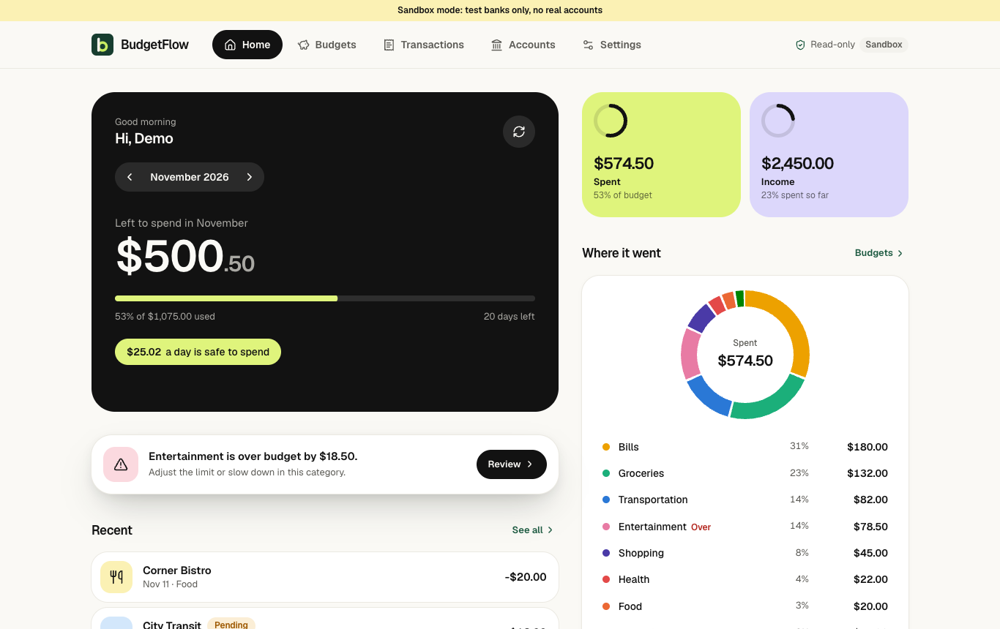
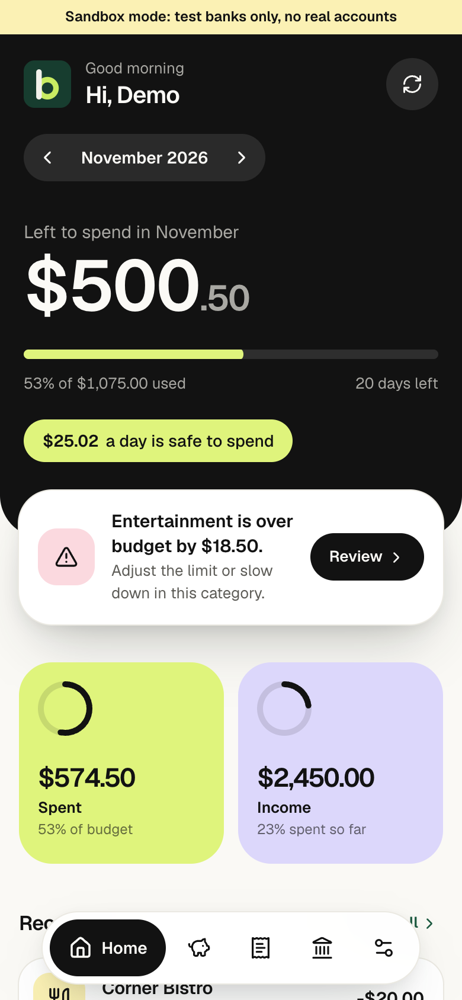
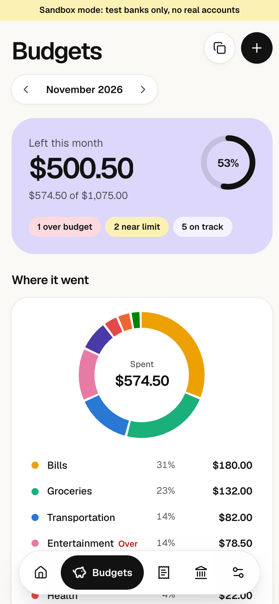
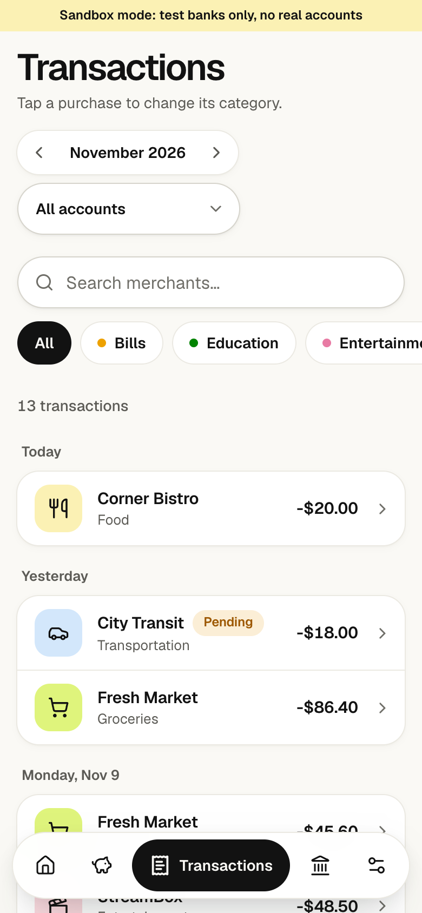
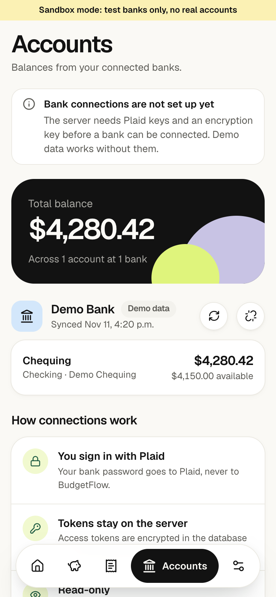
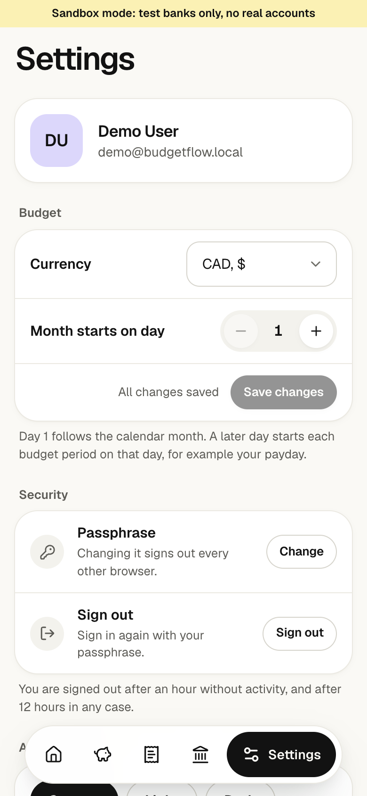
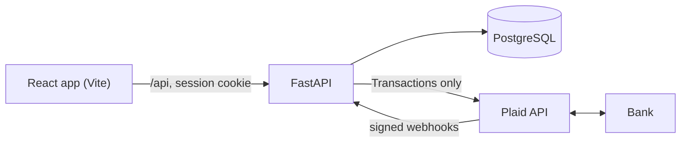

# BudgetFlow

[](https://github.com/miladse1/smart-budget-app/actions/workflows/ci.yml)

A personal budgeting app that reads transactions from a connected bank, sorts each purchase into a
category, and shows how much is left in every monthly budget. Full stack: React and TypeScript on the
front, FastAPI and PostgreSQL on the back, and Plaid for bank data.

BudgetFlow only reads data. It never transfers, withdraws, or moves money. Bank sign-in happens
inside Plaid Link, so the app never sees bank credentials.

<p>
  
  
</p>

*Screenshots use the built-in demo data and Plaid Sandbox. No real accounts are connected.*

## Why

Bank apps show transactions; spreadsheets show budgets. Keeping them in sync by hand is the part
people give up on. BudgetFlow joins them: each synced purchase lands in a category and immediately
reduces that category's monthly budget, so "how much can I still spend on food this month" is always
current.

## Features

- **Monthly budgets per category**, with progress, over-budget alerts, and a safe-to-spend-per-day figure.
- **Bank sync through Plaid** (Sandbox today): Link, public-token exchange on the server, incremental
  `/transactions/sync` with cursors, webhooks, and a manual **Sync** button.
- **Transactions** with search, filters, and one-tap re-categorisation that later syncs respect.
- **Custom budget months** that start on any day, such as payday.
- **First-run onboarding** and a **demo mode** with a realistic sample month, so the whole app works without a bank.
- **Single-owner sign-in** with a passphrase; installable as a mobile-first **PWA** with light and dark themes.

<p>
  
  
  
  
</p>

## Architecture



- The browser talks only to the API, through Vite's same-origin `/api` proxy.
- The API stores budgets, transactions, and **encrypted** Plaid access tokens in PostgreSQL. Spent
  amounts are never stored; they are computed from transactions on every read.
- Plaid talks to the bank. Webhooks are accepted only with a valid Plaid signature.

**Stack:** React 19, TypeScript, Vite, Tailwind CSS, TanStack Query, React Router · FastAPI,
SQLAlchemy 2, Alembic, Pydantic · PostgreSQL 16 · Plaid · Docker Compose · Pytest, mypy, Vitest,
Testing Library · GitHub Actions.

## Engineering decisions

| Problem | Decision |
| --- | --- |
| Plaid's amount sign is the opposite of a bank statement, and income and transfers must not eat into expense budgets | One budget-maths module (`services/budget_math.py`) owns the rules; refunds reduce their category, transfers and income never count as spending. |
| A purchase appears first as *pending*, then again as *posted* | The posted transaction replaces its pending copy using `pending_transaction_id`, so nothing is counted twice. |
| Re-categorising a purchase must update two budgets at once | Spent amounts are derived from transactions, not stored, so every budget is correct on the next read. Manual categories survive later syncs. |
| Sync can be interrupted, or the data can change mid-pagination | Cursor-based `/transactions/sync`; on `TRANSACTIONS_SYNC_MUTATION_DURING_PAGINATION` the sync restarts from the last saved cursor. |
| A stolen database must not expose bank access | Access tokens are Fernet-encrypted before storage and decrypted only inside the Plaid service, right before a call. |
| Startup errors can leak secrets into logs | Settings are validated by a function whose messages name variables, never values; logs pass through a redaction filter. |
| A local app is still reachable by other local processes and web pages | Passphrase sign-in with server-side sessions, an HttpOnly + SameSite=Strict cookie, origin checks on writes, and Host-header checks against DNS rebinding. |

## Security

Security is part of the design, not an afterthought. Summary:

- **Sign-in:** scrypt-hashed passphrase; 256-bit session tokens stored only as hashes; 60-minute idle
  and 12-hour absolute timeouts; rate-limited attempts; changing the passphrase signs out other browsers.
- **API:** every financial endpoint requires a session and filters by owner; strict CORS; cross-site
  writes and unknown hosts refused; 64 KB body limit; security headers; `Cache-Control: no-store`.
- **Bank data:** read-only Plaid product, encrypted tokens, verified webhooks, `/item/remove` on disconnect.
- **Repository:** pre-commit and pre-push hooks (gitleaks with Plaid-specific rules, blocked file
  types, private-detail checks), CI secret scanning over full history, `pip-audit`, `npm audit`, Dependabot.

Details: [SECURITY.md](SECURITY.md). Before any real bank connection: [docs/REAL_BANK_READINESS.md](docs/REAL_BANK_READINESS.md).

## Run it

With Docker Desktop running:

```bash
cp .env.example .env              # demo mode works with Plaid values left empty
docker compose up --build         # app: http://localhost:5173 · API docs: http://localhost:8000/docs
```

Create a passphrase, finish the short onboarding, and choose **demo mode** or connect a Plaid Sandbox
bank (`user_good` / `pass_good`). Running without Docker, Plaid setup, webhooks, and passphrase reset
are covered in [docs/SETUP.md](docs/SETUP.md).

## Tests

```bash
cd backend && python -m pytest -q && python -m mypy app     # 102 tests
cd frontend && npm test && npm run build                    # 14 tests, type check, production build
```

Backend tests run on in-memory SQLite with fake Plaid responses: budget maths, sync edge cases
(pending to posted, removals, re-categorisation), webhook verification, owner isolation, sign-in,
sessions, and request-origin checks. CI also runs every Alembic migration up, down, and up again on PostgreSQL.

## Limitations and next steps

- **Sandbox only.** Real-bank use needs Plaid Production approval and the items in
  [REAL_BANK_READINESS.md](docs/REAL_BANK_READINESS.md), starting with a second sign-in factor and
  keeping keys in the macOS Keychain.
- **Single owner, single process.** Rate limits live in memory; a hosted multi-user version would need
  per-user accounts and a shared store.
- **Next:** TOTP or passkey sign-in, encrypted backups, spending trends across months, and CSV export.

## License

No open-source license is granted; all rights reserved. The code is shared for review as part of a portfolio.
